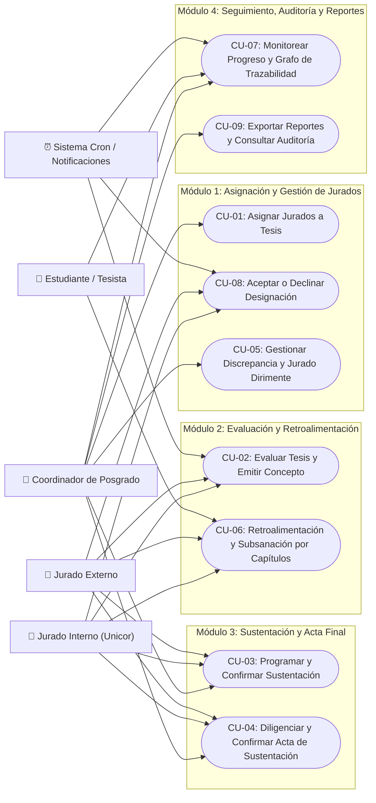
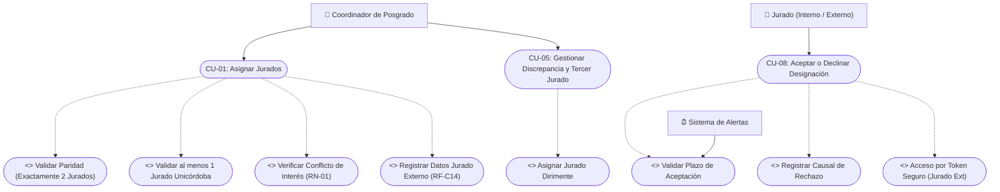
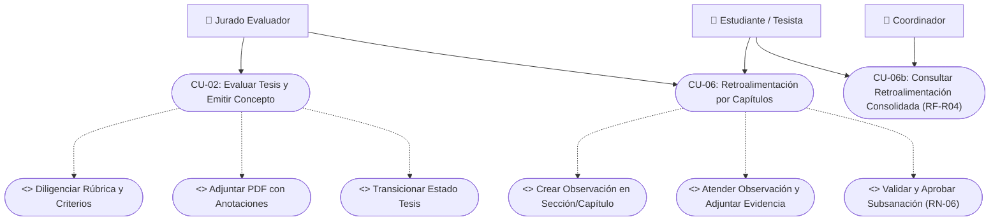
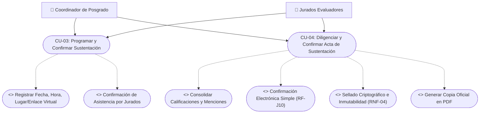
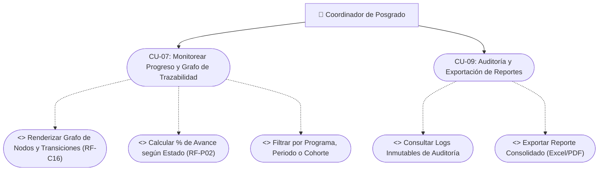

# Especificación de Casos de Uso — Repositorio de Tesis de Posgrados
**Universidad de Córdoba**  
**Foco:** Módulos de Coordinación y Evaluación por Jurados

---

## 1. Introducción y Alcance

El presente documento formaliza los diagramas y especificaciones de Casos de Uso para el sistema de **Repositorio y Gestión de Tesis de Posgrados de la Universidad de Córdoba**, diseñado bajo una arquitectura desacoplada (Frontend en Nuxt 4 + Vuetify 3 y Backend en NestJS con MongoDB Atlas). 

Este modelado cubre de manera exhaustiva el ciclo de vida de evaluación y sustentación académica de tesis, integrando los requisitos funcionales (**RF**), reglas de negocio (**RN**) y requerimientos no funcionales (**RNF**) estipulados en el plan de trabajo.

---

## 2. Actores del Sistema

| Actor | Tipo | Descripción y Responsabilidad |
| :--- | :--- | :--- |
| **Coordinador de Posgrados** | Humano (Primario) | Docente/administrativo a cargo de la gestión del programa académico. Asigna jurados, resuelve discrepancias, supervisa el progreso general, programa sustentaciones, consolida y sella actas, y audita los procesos. |
| **Jurado Interno** | Humano (Primario) | Docente activo con vinculación formal en la Universidad de Córdoba. Acepta designaciones, evalúa tesis, deja observaciones por capítulo, asiste a la sustentación y firma electrónicamente el acta. |
| **Jurado Externo** | Humano (Primario) | Experto académico adscrito a una institución externa nacional o internacional. Accede al sistema a través de un enlace seguro con token temporal (RF-J14) para evaluar y firmar el acta sin necesidad de usuario LDAP/SSO. |
| **Jurado Dirimente** | Humano (Especializado) | Tercer jurado designado por el Coordinador en caso de empate o discrepancia técnica/evaluativa entre los dos jurados principales (RN-08). |
| **Estudiante / Tesista** | Humano (Secundario) | Autor del trabajo de grado. Consulta el estado del proceso, revisa las observaciones por capítulo, sube versiones corregidas y atiende la retroalimentación. |
| **Sistema Cron / Alertas** | Automatizado | Tareas programadas de fondo encargadas de calcular plazos de aceptación/evaluación, alertar vencimientos y notificar cambios de estado vía correo electrónico. |

---

## 3. Diagrama General de Casos de Uso del Sistema

El siguiente diagrama agrupa los casos de uso principales por subsistema funcional y muestra su relación con los distintos actores:

---

## 4. Diagramas de Casos de Uso Detallados por Módulo

### 4.1. Módulo 1: Asignación y Designación de Jurados (CU-01, CU-08, CU-05)

Este módulo gestiona la asignación paritaria con reglas de vinculación institucional (**RF-C13**), detección y bloqueo por conflicto de interés (**RN-01**), registro de jurados externos (**RF-C14**), aceptación en plazo configurable (**RF-J13**) y bifurcación por discrepancia (**RN-08**).

---

### 4.2. Módulo 2: Evaluación de Tesis y Retroalimentación por Capítulos (CU-02, CU-06)

Regula el proceso técnico de revisión documental, emisión del concepto global (**Aprobado, Aprobado con Modificaciones, Rechazado**) y el hilo de retroalimentación interactiva por secciones (**RN-06**).

---

### 4.3. Módulo 3: Sustentación y Acta de Grado (CU-03, CU-04)

Cubre el acuerdo de fechas de defensa pública y la conformación del acta final inmutable con confirmación electrónica simple (**RF-J10, RNF-04**).

---

### 4.4. Módulo 4: Trazabilidad, Auditoría y Progreso (CU-07, CU-09)

Control operacional mediante el grafo interactivo (**Vue Flow / Cytoscape.js - RF-C16**), monitoreo de porcentaje de avance (**RF-P02/P03**) y auditoría inmutable de eventos.

---

## 5. Especificaciones Detalladas de Casos de Uso

---

### CU-01: Asignar Jurados a Tesis
* **Actor Principal:** Coordinador de Posgrados.
* **Actores Secundarios:** Jurados designados (notificación por correo).
* **Precondiciones:**
  1. La tesis se encuentra en estado `RADICADA_PARA_EVALUACION`.
  2. El documento final en PDF se encuentra disponible en el repositorio.
* **Flujo Principal:**
  1. El Coordinador ingresa a la lista de tesis y selecciona una tesis pendiente de jurados.
  2. El sistema despliega los datos del tesista, título, director y codirectores.
  3. El Coordinador selecciona el **Jurado 1** y el **Jurado 2** mediante un selector con autocompletado de docentes vinculados o añade un jurado externo.
  4. Para cada jurado seleccionado, el sistema valida en tiempo real:
     - **Regla RN-01:** El jurado no puede ser el Director ni Codirector de la tesis, ni registrar conflicto de interés documentado.
     - **Regla RF-C13:** Se seleccionan exactamente 2 jurados y al menos uno de ellos posee `institucion_afiliacion = "Universidad de Córdoba"`.
  5. En caso de jurado externo, el Coordinador diligencia los campos complementarios (**RF-C14**): Institución de origen, título máximo, correo electrónico y país.
  6. El Coordinador establece el plazo límite de aceptación (días hábiles configurables).
  7. El Coordinador pulsa **"Confirmar Asignación"**.
  8. El sistema actualiza el estado de la tesis a `JURADOS_ASIGNADOS`, registra la auditoría con timestamp e IP, y dispara las notificaciones por correo a los jurados (con enlace seguro tokenizado para externos).
* **Flujos Alternos y Excepciones:**
  * **FA-01 (Conflicto de Interés detectado):** El jurado seleccionado figura como director/codirector de la tesis. El sistema bloquea la acción, muestra alerta en rojo: *"Acción no permitida: el docente posee conflicto de interés directo con este trabajo"* e impide el guardado.
  * **FA-02 (Incumplimiento de filiación institucional):** Se intentan registrar 2 jurados externos sin jurado de Unicórdoba. El sistema resalta la advertencia de negocio y deshabilita el botón de confirmación hasta seleccionar al menos un docente de la Universidad de Córdoba.
* **Postcondiciones:**
  * Se crean los registros en la colección `AsignacionJurado`.
  * La tesis pasa a estado `JURADOS_ASIGNADOS` con porcentaje de avance actualizado.

---

### CU-08: Aceptar o Declinar Designación de Jurado
* **Actor Principal:** Jurado (Interno o Externo).
* **Actores Secundarios:** Coordinador de Posgrados.
* **Precondiciones:**
  * El jurado ha recibido la designación formal para una tesis en estado `JURADOS_ASIGNADOS`.
  * El jurado accede autenticado (Jurado Interno vía JWT) o a través de token seguro único (**RF-J14** para Jurado Externo).
* **Flujo Principal:**
  1. El jurado ingresa al detalle de la asignación.
  2. El sistema muestra: Título del proyecto, resumen ejecutivo, estudiante, director, programa y fecha límite para responder.
  3. Si el jurado pulsa **"Aceptar Designación"**:
     a. El sistema registra la aceptación y la fecha/hora.
     b. El estado de la asignación pasa a `ACEPTADO`.
     c. Cuando ambos jurados aceptan, la tesis pasa a estado `EN_EVALUACION` y se habilitan los accesos al manuscrito completo.
     d. Se notifica al Coordinador y al Estudiante.
* **Flujos Alternos y Excepciones:**
  * **FA-01 (El jurado declina la designación):**
     1. El jurado pulsa **"Declinar Designación"**.
     2. El sistema exige ingresar obligatoriamente un motivo justificado (máximo 500 caracteres).
     3. El jurado confirma la declinación.
     4. El sistema registra la declinación, devuelve el slot de la tesis a `ASIGNACION_PENDIENTE_REEMPLAZO` y genera una alerta prioritaria en el panel del Coordinador.
  * **FA-02 (Vencimiento de plazo por inactividad):**
     1. El cron job detecta que expiraron los días hábiles concedidos sin respuesta.
     2. El sistema marca la asignación como `EXPIRADA_SIN_RESPUESTA` y notifica al Coordinador para reasignación.
* **Postcondiciones:**
  * El jurado queda facultado para evaluar si aceptó, o se libera la vacante para reasignación si declinó.

---

### CU-02: Evaluar Tesis y Emitir Concepto
* **Actor Principal:** Jurado Evaluador.
* **Actores Secundarios:** Coordinador de Posgrado, Estudiante.
* **Precondiciones:**
  * La asignación del jurado está en estado `ACEPTADO` y la tesis está `EN_EVALUACION`.
* **Flujo Principal:**
  1. El jurado abre el visor de evaluación de la tesis.
  2. Visualiza el manuscrito en visor PDF embebido con herramientas de navegación.
  3. Diligencia la rúbrica estructurada:
     - Claridad metodológica y rigor científico (1 a 5).
     - Relevancia y aporte disciplinar (1 a 5).
     - Calidad de redacción y cumplimiento de normas (1 a 5).
  4. Ingresa el concepto evaluativo final:
     - `APROBADO_PARA_SUSTENTAR`
     - `APROBADO_CON_MODIFICACIONES`
     - `NO_APROBADO_RECHAZADO`
  5. Ingresa observaciones generales y, opcionalmente, adjunta un archivo PDF con comentarios al margen (**RF-J03**).
  6. El jurado revisa el resumen y pulsa **"Emitir Concepto Oficial"**.
  7. El sistema valida el formulario, marca la evaluación como `CONCEPTO_EMITIDO` y bloquea la edición posterior.
  8. El sistema evalúa si ambos jurados ya emitieron concepto para activar el flujo de concordancia o discrepancia (**RN-08**).
* **Postcondiciones:**
  * Evaluación consolidada en base de datos.
  * Si ambos jurados aprueban, la tesis transiciona a `LISTA_PARA_SUSTENTACION`.

---

### CU-05: Gestión de Discrepancia y Jurado Dirimente
* **Actor Principal:** Coordinador de Posgrados.
* **Actores Secundarios:** Jurado Dirimente, Jurados Evaluadores Originales.
* **Precondiciones:**
  * Ambos jurados han emitido conceptos contradictorios no conciliables (p.ej., uno aprueba y el otro rechaza).
  * El sistema ha transicionado la tesis automáticamente a `EN_DISCREPANCIA_REQUIERE_DIRIMENTE` (**RN-08**).
* **Flujo Principal:**
  1. El Coordinador ingresa a la bandeja de alertas y abre la tesis en discrepancia.
  2. Visualiza el cuadro comparativo de los dos conceptos, observaciones y rúbricas.
  3. El Coordinador pulsa **"Designar Jurado Dirimente"**.
  4. Selecciona un tercer jurado cumpliendo nuevamente las validaciones de idoneidad y conflicto de interés (**RN-01**).
  5. El sistema notifica al tercer jurado asignándole la tesis en modo de evaluación dirimente.
  6. El jurado dirimente emite su concepto final dirimente (`APROBADO` o `RECHAZADO`).
  7. El concepto del dirimente define la decisión definitiva y la tesis adopta el nuevo estado consensuado.
* **Postcondiciones:**
  * Se dirime la discrepancia y el proceso de la tesis continúa hacia sustentación o cierre de proyecto.

---

### CU-06: Gestión de Retroalimentación Granular por Capítulo
* **Actor Principal:** Jurado Evaluador y Estudiante.
* **Actores Secundarios:** Coordinador (monitoreo RF-R04).
* **Regla de Negocio RN-06:** Control estricto de roles en las transiciones de las observaciones:
  * El **Jurado** crea la observación con estado `Pendiente`.
  * El **Estudiante** responde, adjunta el ajuste y pasa la observación a `Atendida`.
  * El **Jurado** valida la corrección y es el **ÚNICO** autorizado para marcarla como `Aprobada-Subsanada`, o reabrirla a `Pendiente` si el ajuste es insatisfactorio.
* **Flujo Principal:**
  1. En el visor de tesis, el jurado selecciona un capítulo o sección específica (p.ej. "Capítulo 3: Metodología").
  2. El jurado crea una nota de retroalimentación detallando la corrección requerida.
  3. El sistema almacena la nota en estado `Pendiente` y envía una notificación consolidada al estudiante.
  4. El estudiante ingresa a su panel, ubica la observación `Pendiente` y redacta la respuesta justificando el cambio junto con la página o archivo de fe de erratas.
  5. El estudiante pulsa **"Marcar como Atendida"**.
  6. El jurado recibe la alerta, compara el cambio realizado y pulsa **"Aprobar Subsanación"** (estado final `Aprobada-Subsanada`).
* **Postcondiciones:**
  * Todas las observaciones deben quedar en estado `Aprobada-Subsanada` antes de que el Coordinador pueda generar el acta de sustentación.

---

### CU-03: Programar y Confirmar Sustentación
* **Actor Principal:** Coordinador de Posgrados.
* **Actores Secundarios:** Jurados Evaluadores, Estudiante.
* **Precondiciones:**
  * Tesis en estado `LISTA_PARA_SUSTENTACION` con conceptos favorables y observaciones subsanadas.
* **Flujo Principal:**
  1. El Coordinador ingresa al módulo de sustentaciones.
  2. Registra los parámetros de la sesión:
     - Fecha y hora pactadas.
     - Modalidad: Presencial (Aula/Auditorio), Virtual (Enlace Google Meet/Teams) o Híbrida.
     - Lugar físico o enlace de videoconferencia.
  3. El Coordinador pulsa **"Programar Sustentación"**.
  4. El sistema remite una invitación de confirmación manual a los jurados y al estudiante.
  5. Cada jurado confirma disponibilidad desde su panel con un clic.
  6. Al confirmarse por los jurados, el estado de la tesis pasa a `SUSTENTACION_PROGRAMADA`.
* **Postcondiciones:**
  * Calendario de sustentación oficializado y visible en el panel del estudiante y jurados.

---

### CU-04: Diligenciar y Confirmar Acta de Sustentación
* **Actor Principal:** Coordinador de Posgrados y Jurados Evaluadores.
* **Precondiciones:**
  * Sustentación culminada y tesis en estado `SUSTENTACION_PROGRAMADA`.
* **Flujo Principal:**
  1. El Coordinador pulsa **"Diligenciar Acta de Sustentación"**.
  2. El sistema precarga la plantilla oficial con todos los metadatos: Estudiante, Programa, Título, Jurados, Fecha y Modalidad.
  3. Los jurados y el coordinador deliberan e ingresan:
     - Calificación numérica final (0.0 a 5.0).
     - Veredicto final: `APROBADA`, `APROBADA CON DISTINCIÓN MERITORIA`, `APROBADA CON DISTINCIÓN LAUREADA` o `REPROBADA`.
     - Observaciones finales del jurado.
  4. Se activa el panel de **Confirmación Electrónica Simple (RF-J10)**:
     - Cada jurado y el coordinador marcan el checkbox de aceptación legal y pulsan **"Firmar Acta Electrónicamente"**.
     - El backend captura: ID de usuario, IP de conexión, fecha/hora exacta y genera un **Hash criptográfico SHA-256** del contenido del acta.
  5. Una vez recopiladas las 3 confirmaciones (2 jurados + 1 coordinador):
     - El sistema sella el acta con bandera `CERRADA_INMUTABLE` (**RNF-04**).
     - Se bloquea cualquier edición posterior de calificaciones o textos.
     - Se compila y almacena el PDF final sellado en MongoDB Atlas GridFS.
     - La tesis pasa al estado final `FINALIZADA_APROBADA` o `FINALIZADA_REPROBADA`.
* **Postcondiciones:**
  * Acta inalterable firmada electrónicamente y descargable por todas las partes interesadas.

---

### CU-07: Monitorear Progreso y Grafo de Trazabilidad
* **Actor Principal:** Coordinador de Posgrados.
* **Actores Secundarios:** Estudiante (solo consulta de su tesis).
* **Precondiciones:**
  * Usuario con sesión activa.
* **Flujo Principal:**
  1. El Coordinador ingresa a la pestaña **"Trazabilidad & Progreso"**.
  2. Aplica filtros por programa de posgrado, cohorte o periodo académico.
  3. Visualiza la tabla resumen con barra de progreso porcentual (**RF-P02/P03**) calculado dinámicamente según la máquina de estados:
     * `RADICADA`: 10%
     * `JURADOS_ASIGNADOS`: 25%
     * `EN_EVALUACION`: 45%
     * `OBSERVACIONES_EN_SUBSANACION`: 60%
     * `LISTA_PARA_SUSTENTACION`: 75%
     * `SUSTENTACION_PROGRAMADA`: 85%
     * `FINALIZADA_CON_ACTA`: 100%
  4. Al hacer clic en una tesis, se abre el **Grafo Interactivo de Trazabilidad (RF-C16)** renderizado con Vue Flow / Cytoscape.js.
  5. Cada nodo representa un hito o estado, mostrando timestamps reales, actor que ejecutó la transición y enlaces a las evidencias (conceptos, actas, cartas).
* **Postcondiciones:**
  * Visibilidad completa e interactiva de la ruta crítica y auditoría de la tesis.

---

## 6. Matriz de Trazabilidad: Requisitos vs. Casos de Uso

| Código Requisito / Regla | Descripción Corta | Caso de Uso Vinculado |
| :--- | :--- | :--- |
| **RF-C01** | Listado y filtrado de tesis de posgrado | CU-01, CU-07 |
| **RF-C13** | Reglas de asignación: 2 jurados y mínimo 1 Unicórdoba | CU-01 |
| **RF-C14** | Formulario y metadatos de Jurado Externo | CU-01 |
| **RN-01** | Bloqueo por conflicto de interés (Director/Codirector/Parentesco) | CU-01, CU-05 |
| **RF-J13** | Aceptar o declinar designación con plazo configurable | CU-08 |
| **RF-J14** | Acceso express tokenizado para Jurados Externos | CU-08, CU-02, CU-04 |
| **RF-J03 / CU-02** | Formulario de evaluación, concepto y PDF de observaciones | CU-02 |
| **RN-06** | Control de roles en ciclo de retroalimentación (Pendiente/Atendida/Aprobada) | CU-06 |
| **RF-R04** | Vista consolidada de retroalimentación por tesis | CU-06 |
| **RN-08** | Lógica de discrepancia entre jurados y bifurcación a dirimente | CU-05 |
| **CU-03** | Programación manual de fecha, hora y modalidad de sustentación | CU-03 |
| **CU-04 / RF-J10** | Confirmación electrónica simple de acta de sustentación | CU-04 |
| **RNF-04** | Inmutabilidad de acta y evidencias post-firma | CU-04, CU-09 |
| **RF-P02 / RF-P03** | Cálculo de porcentaje de avance según estado | CU-07 |
| **RF-C16** | Grafo de trazabilidad interactivo (nodos y aristas) | CU-07 |
| **RF-C09 / RF-S05** | Exportación de reportes a PDF y Excel | CU-09 |
