# Mapa de Navegación y Matriz de Restricciones de Usuario (RBAC)
**Repositorio de Tesis de Posgrados — Universidad de Córdoba**  
**Tecnología Frontend:** Nuxt 4 (SSR/SPA) + Vuetify 3

---

## 1. Introducción

Este documento define la **Arquitectura de Información (AI)**, el **Mapa de Navegación** y la **Matriz de Control de Acceso Basado en Roles (RBAC)** para la plataforma de gestión y repositorio de tesis.

El diseño de navegación está estructurado para proporcionar flujos limpios, reduciendo la fricción cognitiva entre los dos actores principales: **Coordinador de Posgrado** y **Jurados Evaluadores (Internos y Externos)**, garantizando a la vez que las restricciones de negocio y seguridad se apliquen tanto en la interfaz (vistas y componentes dinámicos) como en la capa de guards del cliente (Nuxt Middlewares).

---

## 2. Mapa Integral de Navegación

El siguiente diagrama ilustra la jerarquía de rutas, pantallas, modales y transiciones según el estado de autenticación y rol del usuario:

```mermaid
flowchart TD
    %% Vistas Públicas / Autenticación
    Inicio["🌐 Portal Principal / Landing"]
    Login["🔐 Login Institucional (Email + Password)"]
    TokenAuth["🔑 Acceso Jurado Externo (?token=XYZ)"]

    %% Decisiones de Enrutamiento
    AuthGuard{"Middleware: ¿Autenticado y Rol?"}
    
    Inicio --> Login
    Inicio --> TokenAuth
    Login --> AuthGuard
    TokenAuth --> AuthGuard

    %% Ramas de Navegación por Rol
    AuthGuard -- "Rol: Coordinador" --> PortalCoord["🏢 Portal Coordinador"]
    AuthGuard -- "Rol: Jurado Interno" --> PortalJurado["👨‍🏫 Portal Jurado"]
    AuthGuard -- "Token: Jurado Externo" --> PortalJuradoExt["🌍 Portal Jurado Externo (Express)"]
    AuthGuard -- "Rol: Estudiante" --> PortalEstudiante["🎓 Portal Estudiante"]

    %% Módulos del Coordinador
    subgraph Coordinador_Views["Vistas Coordinador de Posgrado"]
        PortalCoord --> DashCoord["📊 Dashboard Principal (Métricas, Estados y Alertas)"]
        PortalCoord --> TesisList["📁 Bandeja General de Tesis (Filtros Programa/Cohorte)"]
        
        TesisList --> ModalAsignar["➕ Modal / Vista: Asignación de 2 Jurados (CU-01)"]
        TesisList --> VistaDiscrepancia["⚠️ Vista: Gestión de Discrepancia y Dirimente (CU-05)"]
        TesisList --> VistaConsolObs["💬 Vista: Retroalimentación Consolidada (CU-06b)"]

        PortalCoord --> SustentacionesCoord["🗓️ Programación de Sustentaciones (CU-03)"]
        SustentacionesCoord --> ModalProgSust["➕ Formulario: Fecha, Hora y Modalidad"]

        PortalCoord --> ActasCoord["📜 Gestión y Cierre de Actas (CU-04)"]
        ActasCoord --> VistaFirmaActaCoord["✍️ Diligenciamiento y Confirmación Electrónica"]

        PortalCoord --> TrazabilidadView["🕸️ Grafo Interactivo de Trazabilidad (CU-07)"]
        PortalCoord --> AuditoriaView["🛡️ Bitácora Inmutable de Auditoría"]
        PortalCoord --> ReportesView["📑 Exportación de Reportes (PDF / Excel)"]
    end

    %% Módulos del Jurado Interno
    subgraph Jurado_Views["Vistas Jurado Evaluador"]
        PortalJurado --> DashJurado["📋 Mis Tesis Asignadas"]
        
        DashJurado --> ModalDecision["⚖️ Aceptar / Declinar Designación (CU-08)"]
        DashJurado --> EvaluadorTesis["📝 Formulario de Evaluación y Rúbrica (CU-02)"]
        EvaluadorTesis --> VisorPDF["📖 Visor de Tesis con Herramientas de Anotación"]
        
        DashJurado --> HiloRetro["💬 Hilo de Observaciones por Capítulo (CU-06)"]
        HiloRetro --> ModalAprobarSub["✅ Validar / Aprobar Subsanación"]

        DashJurado --> SustJurado["🗓️ Confirmación de Asistencia a Sustentación"]
        DashJurado --> ActaJurado["✍️ Firma Electrónica del Acta (CU-04)"]
    end

    %% Módulos del Jurado Externo (Layout Simplificado)
    subgraph JuradoExt_Views["Vistas Jurado Externo (Token Express)"]
        PortalJuradoExt --> ResumenToken["📄 Resumen del Trabajo Asignado"]
        ResumenToken --> ModalDecisionExt["⚖️ Aceptar / Declinar"]
        ResumenToken --> EvaluadorExt["📝 Formulario de Evaluación Simplificado"]
        ResumenToken --> FirmaActaExt["✍️ Confirmación Electrónica del Acta"]
    end

    %% Módulos del Estudiante
    subgraph Estudiante_Views["Vistas Estudiante / Tesista"]
        PortalEstudiante --> DashEst["📌 Estado de Mi Tesis (% Avance)"]
        DashEst --> ObsEstudiante["📝 Bandeja de Observaciones Recibidas"]
        ObsEstudiante --> ModalAtenderObs["📤 Atender Observación y Adjuntar Evidencia"]
        DashEst --> SustEstudiante["🗓️ Datos de Mi Sustentación (Fecha y Enlace)"]
        DashEst --> DescargarActa["📥 Descarga de Acta Final Sellada"]
    end
```



---

## 3. Matriz de Control de Acceso Basado en Roles (RBAC)

La siguiente matriz detalla exhaustivamente los permisos y restricciones por cada funcionalidad del sistema:

| Módulo / Funcionalidad | Código CU | Coordinador | Jurado Interno | Jurado Externo | Estudiante | Administrador | Regla de Negocio / Restricción |
| :--- | :---: | :---: | :---: | :---: | :---: | :---: | :--- |
| **Login Institucional (JWT)** | — | ✅ Total | ✅ Total | ❌ No | ✅ Total | ✅ Total | Credenciales institucionales. |
| **Acceso Express por Token** | RF-J14 | ❌ No | ❌ No | ✅ Exclusivo | ❌ No | ❌ No | Enlace seguro firmado con expiración. |
| **Bandeja General de Tesis** | RF-C01 | ✅ Total | ❌ No | ❌ No | ❌ No | ✅ Lectura | Vista global con filtros de programa/cohorte. |
| **Asignación de Jurados** | CU-01 | ✅ Total | ❌ No | ❌ No | ❌ No | ❌ No | Exactamente 2 jurados; mínimo 1 Unicor (RF-C13); no conflicto (RN-01). |
| **Aceptar / Declinar Designación** | CU-08 | ❌ No | ✅ Asignadas | ✅ Asignadas | ❌ No | ❌ No | Plazo límite en días hábiles (RF-J13); motivo obligatorio si declina. |
| **Descarga / Visualización de Manuscrito** | — | ✅ Total | ✅ Si Aceptó | ✅ Si Aceptó | ✅ Propia | ✅ Total | Disponible para el jurado solo tras aceptar designación. |
| **Emisión de Concepto Evaluativo** | CU-02 | ❌ No | ✅ Si Aceptó | ✅ Si Aceptó | ❌ No | ❌ No | Rúbrica + concepto + PDF opcional. Inmutable post-envío. |
| **Crear Observaciones por Capítulo** | CU-06 | ❌ No | ✅ Si Aceptó | ✅ Si Aceptó | ❌ No | ❌ No | Crea notas en estado `Pendiente`. |
| **Atender y Subsanar Observaciones** | CU-06 | ❌ No | ❌ No | ❌ No | ✅ Propia | ❌ No | Solo el estudiante puede pasar a `Atendida` (RN-06). |
| **Aprobar / Cerrar Subsanación** | CU-06 | ❌ No | ✅ Evaluador | ✅ Evaluador | ❌ No | ❌ No | Solo el jurado emisor puede marcar `Aprobada-Subsanada` (RN-06). |
| **Resolver Discrepancia (Dirimente)** | CU-05 | ✅ Total | ❌ No | ❌ No | ❌ No | ❌ No | Se activa solo en estado `EN_DISCREPANCIA` (RN-08). |
| **Programar Fecha de Sustentación** | CU-03 | ✅ Total | ❌ No | ❌ No | ❌ No | ❌ No | Requiere conceptos aprobatorios y subsanación completa. |
| **Confirmar Asistencia a Sustentación** | CU-03 | ❌ No | ✅ Confirmar | ✅ Confirmar | 👁️ Consulta | ❌ No | Confirmación manual sin sincronización externa. |
| **Diligenciar Calificación de Acta** | CU-04 | ✅ Coordina | ✅ Delibera | ✅ Delibera | ❌ No | ❌ No | Consolidación de notas y menciones de honor. |
| **Firma / Confirmación Electrónica** | RF-J10 | ✅ Firma | ✅ Firma | ✅ Firma | ❌ No | ❌ No | Checkbox legal + Timestamp + Hash SHA-256 (RNF-04). |
| **Ver Grafo de Trazabilidad** | RF-C16 | ✅ Interactivo | 👁️ Parcial | ❌ No | 👁️ Propia | ✅ Total | Renderizado interactivo con Vue Flow / Cytoscape.js. |
| **Descargar Reportes (Excel / PDF)** | CU-09 | ✅ Total | ❌ No | ❌ No | ❌ No | ✅ Total | Reportes gerenciales por cohorte y programa. |
| **Bitácora de Auditoría** | RNF-04 | 👁️ Solo Lectura| ❌ No | ❌ No | ❌ No | ✅ Total | Registro inmutable de transiciones y eventos. |

---

## 4. Estructura de Rutas Frontend (Nuxt 4 Pages Structure)

La aplicación utiliza la convención de enrutamiento basado en archivos de Nuxt:

```text
pages/
├── index.vue                                # Redirección inteligente según rol
├── login.vue                                # Inicio de sesión unificado
├── auth/
│   └── external-access.vue                  # Validador de Magic Link/Token jurado externo
├── coordinador/
│   ├── index.vue                            # Dashboard con KPIs y alertas
│   ├── tesis/
│   │   ├── index.vue                        # Listado general con filtros avanzados
│   │   └── [id]/
│   │       ├── index.vue                    # Ficha técnica de la tesis
│   │       ├── asignar-jurados.vue          # Formulario con validaciones RN-01 y RF-C13
│   │       ├── discrepancia.vue             # Comparativa y asignación de dirimente (CU-05)
│   │       └── trazabilidad.vue             # Grafo Vue Flow / Cytoscape.js (CU-07)
│   ├── sustentaciones/
│   │   ├── index.vue                        # Calendario y programación de sustentaciones
│   │   └── [id].vue                         # Gestión particular de la sustentación
│   ├── actas/
│   │   └── [id].vue                         # Diligenciamiento, firmas y cierre inmutable
│   ├── reportes.vue                         # Generador de reportes PDF/Excel
│   └── auditoria.vue                        # Panel de eventos y logs inmutables
├── jurado/
│   ├── index.vue                            # Mis asignaciones (pendientes y activas)
│   └── evaluacion/
│       └── [id]/
│           ├── index.vue                    # Ficha de evaluación y aceptación/declinación
│           ├── visor.vue                    # Lector PDF + Formulario rúbrica
│           ├── retroalimentacion.vue        # Hilo interactivo por capítulos
│           └── acta.vue                     # Firma electrónica del acta
├── estudiante/
│   ├── index.vue                            # Estado de la tesis y porcentaje de avance
│   ├── observaciones.vue                    # Bandeja de subsanación de correcciones
│   └── acta.vue                             # Descarga de acta final y soporte
└── admin/
    ├── usuarios.vue                         # Gestión de usuarios y perfiles
    └── configuracion.vue                    # Plazos hábiles globales y plantillas
```

---

## 5. Middlewares de Ruta y Guards en Nuxt 4

Para asegurar que las restricciones de usuario sean impenetrables a nivel de navegación, se implementan los siguientes middlewares:

### 5.1. `middleware/auth.global.ts`
* Intercepta todas las rutas excepto las públicas (`/`, `/login`, `/auth/external-access`).
* Verifica la vigencia del token JWT institucional almacenado en cookie segura `httpOnly`.
* Si el token no existe o expiró, redirige inmediatamente a `/login` preservando la ruta previa en el parámetro de consulta `?redirect=...`.

### 5.2. `middleware/role-coordinador.ts`
* Asignado a todo el directorio `/coordinador/**`.
* Valida que el `user.rol === 'COORDINADOR'` o `'ADMIN'`.
* En caso de discrepancia, bloquea el acceso con código HTTP 403 y redirige al dashboard correspondiente al rol real del usuario con un snackbar de advertencia: *"Acceso restringido a la coordinación del programa"*.

### 5.3. `middleware/role-jurado.ts`
* Asignado a las rutas `/jurado/**`.
* Valida que el usuario posea el rol `'JURADO_INTERNO'` o disponga de una sesión activa de `'JURADO_EXTERNO'`.
* Restringe la vista únicamente a las tesis donde el usuario está formalmente registrado en la colección `AsignacionJurado`.

### 5.4. `middleware/external-token.ts`
* Valida el parámetro `?token=...` en `/auth/external-access`.
* Consulta al endpoint backend `/api/auth/external/validate-token`.
* Si el token es válido, crea una sesión volátil en memoria y monta un **Layout Minimalista (External Layout)** sin barra lateral institucional completa, permitiendo únicamente interactuar con la tesis asignada.

---

## 6. Restricciones Dinámicas en Componentes de Interfaz

Además del bloqueo a nivel de ruta, los componentes visuales aplican reglas de deshabilitado y ocultamiento condicional:

1. **Botón "Confirmar Asignación de Jurados":**
   * Deshabilitado permanentemente hasta que se cumplan las 3 condiciones:
     * Jurado 1 seleccionado.
     * Jurado 2 seleccionado.
     * Al menos uno pertenece a `"Universidad de Córdoba"`.
     * Ninguno es director ni codirector de la tesis.
2. **Botón "Emitir Concepto Oficial":**
   * Oculto si el jurado no ha aceptado formalmente la designación.
   * Deshabilitado si hay campos de rúbrica vacíos.
   * Reemplazado por badge estático *"Concepto Emitido el [Fecha]"* una vez guardado (inmutabilidad).
3. **Botón "Aprobar Subsanación":**
   * Visible únicamente para el Jurado Evaluador.
   * Solo clickeable si el estado de la observación es `Atendida` (el estudiante ya subió evidencia).
4. **Panel de Firma de Acta:**
   * El botón "Firmar Acta" queda deshabilitado para el Coordinador hasta que ambos jurados hayan registrado su confirmación electrónica previa.
   * Una vez firmada por los 3 participantes, todos los controles de entrada (notas, veredictos) se convierten en etiquetas de texto de solo lectura y se despliega el botón *"Descargar PDF Oficial con Sello Criptográfico"*.
